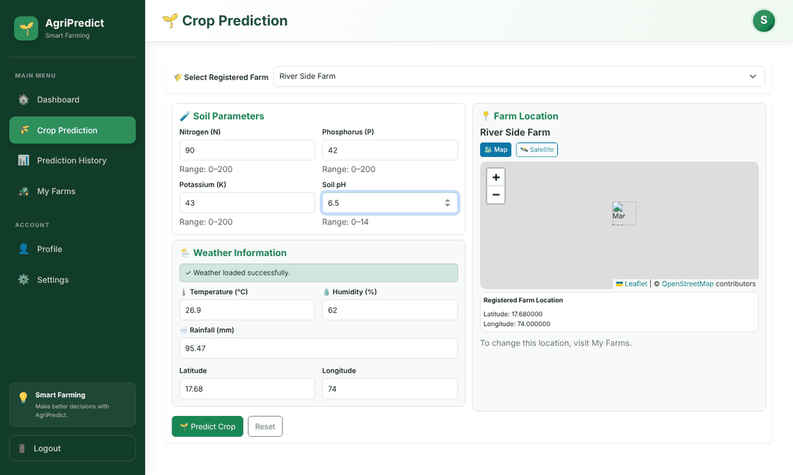
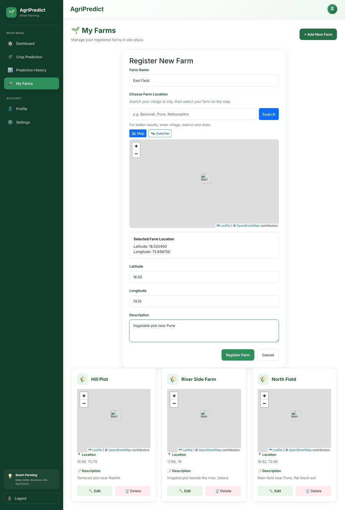
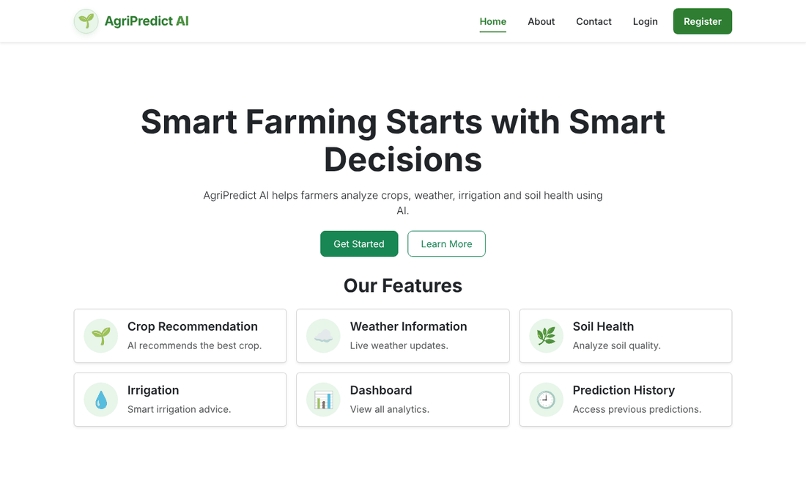
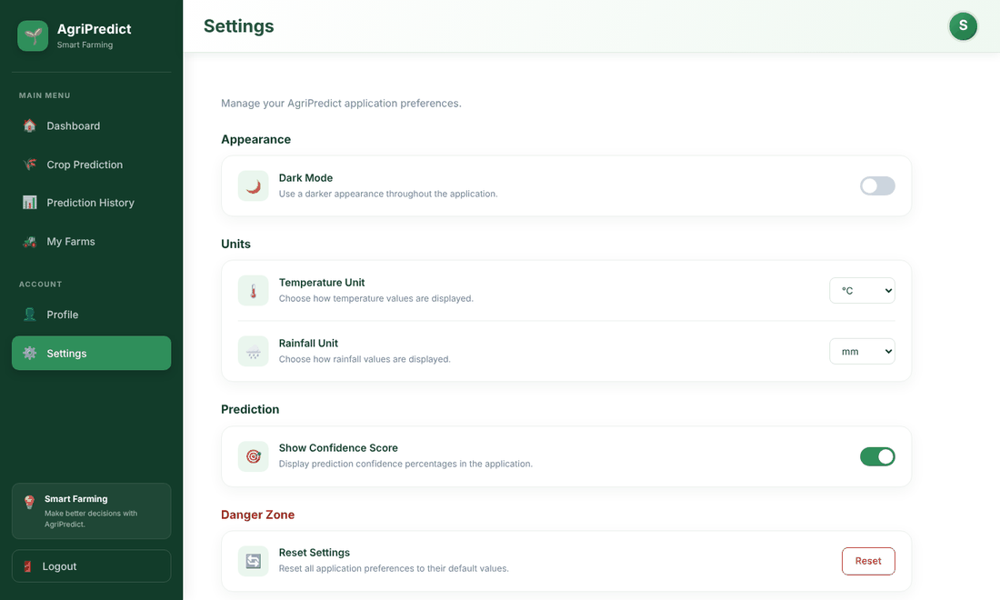
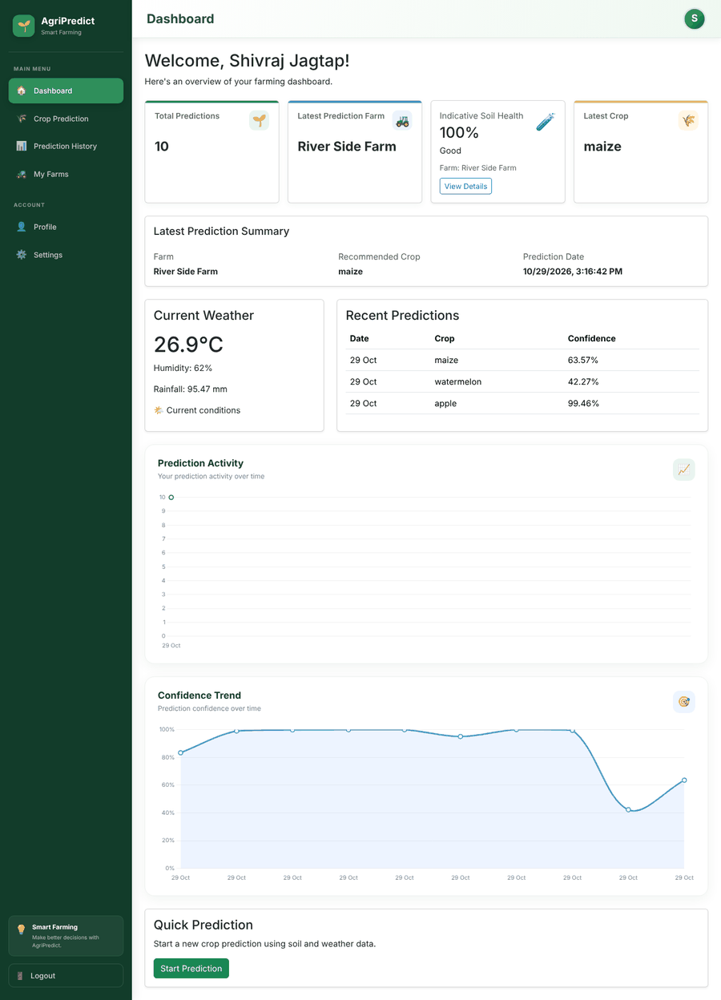
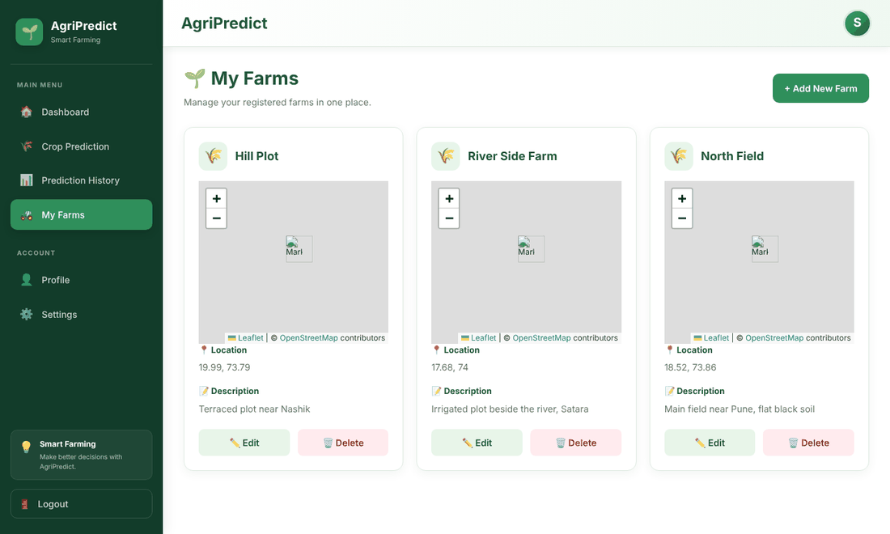
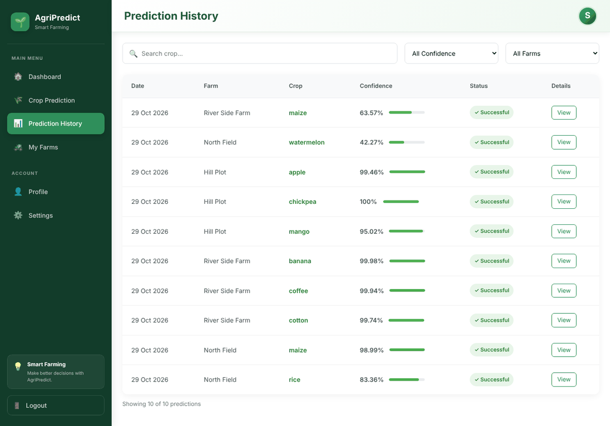
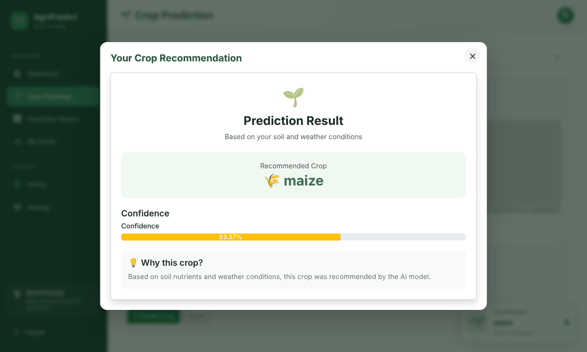
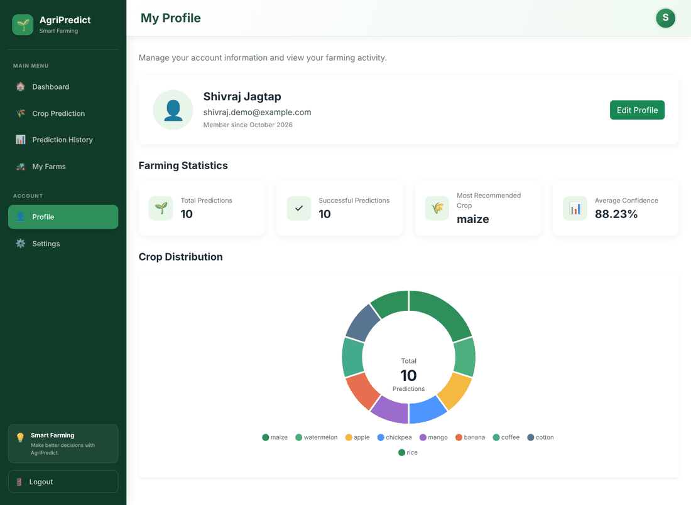

<div align="center">

# 🌱 AgriPredict AI

**An AI-powered smart farming assistant that recommends the best crop for a farm using soil nutrients, soil pH and live weather data.**

[](https://agri-predict-ai-eosin.vercel.app/)


[Live Demo](https://agri-predict-ai-eosin.vercel.app/) · [Report a Bug](https://github.com/shivraj2328/AgriPredict-AI/issues) · [Request a Feature](https://github.com/shivraj2328/AgriPredict-AI/issues)

</div>



---

## 📑 Table of Contents

- [About the Project](#-about-the-project)
- [Features](#-features)
- [Screenshots](#-screenshots)
- [Tech Stack](#-tech-stack)
- [System Architecture](#-system-architecture)
- [The AI Model](#-the-ai-model)
- [Project Structure](#-project-structure)
- [Getting Started](#-getting-started)
- [Environment Variables](#-environment-variables)
- [API Reference](#-api-reference)
- [Data Model](#-data-model)
- [Testing](#-testing)
- [Limitations and Roadmap](#-limitations-and-roadmap)
- [Documentation](#-documentation)
- [Team](#-team)
- [Acknowledgements](#-acknowledgements)

---

## 📌 About the Project

Choosing the right crop is usually based on experience and guesswork. Soil test values and weather data live in different places, and farmers rarely get a measure of how reliable a recommendation is.

**AgriPredict AI** brings these together. A farmer registers one or more farms on a map, enters soil values (Nitrogen, Phosphorus, Potassium and pH), and the system automatically fetches temperature, humidity and rainfall for the farm location. A neural network trained on a 22-crop dataset then recommends the most suitable crop with a **confidence percentage**. Every prediction is stored per user and per farm, so history, soil health and statistics can be reviewed later.

> **Model accuracy:** ≈ **98.18 %** on a held-out test set of 440 samples (22 crops, 2,200-row dataset).

---

## ✨ Features

| Area | What you get |
| ---- | ------------ |
| 🔐 **Authentication** | Register, login, logout, bcrypt password hashing, JWT sessions (1 day), protected routes |
| 🚜 **Multi-farm management** | Add, edit and delete farms; pick the location on an interactive Leaflet map with place search |
| 🌾 **Crop prediction** | Soil inputs with validated ranges, recommendation among 22 crops, confidence score |
| 🌦️ **Live weather** | Temperature, humidity and mean monthly rainfall fetched from Open-Meteo for the selected farm |
| 🧪 **Soil health score** | Indicative 0–100 score from N, P, K and pH against ideal ranges |
| 📊 **Dashboard** | Statistic cards, weather widget, recent predictions, prediction activity and confidence-trend charts |
| 🕘 **Prediction history** | Search by crop, filter by confidence and by farm, view full details of every prediction |
| 👤 **Profile** | Edit name and email, view total predictions, average confidence and crop distribution chart |
| ⚙️ **Settings** | Dark mode, temperature unit (°C / °F), rainfall unit (mm / inch), show/hide confidence |
| 🔒 **Data isolation** | Every user can only read and modify their own farms and predictions |

---

## 🖼️ Screenshots

> Captured from the app running locally with a demo account (3 farms, 10 predictions).

### Authentication

| Register | Login |
| :---: | :---: |
|  |  |

### Dashboard



### Farm Management

| My Farms | Register a New Farm |
| :---: | :---: |
|  |  |

### Crop Prediction

| Select farm and enter soil values | Prediction result |
| :---: | :---: |
|  |  |

### History, Profile and Settings

| Prediction History | Profile |
| :---: | :---: |
|  |  |



---

## 🛠️ Tech Stack

**Frontend** (`client/`)

- [React 19](https://react.dev/) + [Vite 8](https://vite.dev/)
- [React Router 7](https://reactrouter.com/) for routing and protected pages
- [Axios](https://axios-http.com/) with a request interceptor that attaches the JWT
- [Bootstrap 5](https://getbootstrap.com/) + component-level CSS
- [Chart.js](https://www.chartjs.org/) via `react-chartjs-2`
- [Leaflet](https://leafletjs.com/) via `react-leaflet` (OpenStreetMap tiles)

**Backend** (`server/`)

- [Node.js](https://nodejs.org/) + [Express 5](https://expressjs.com/) REST API
- [Mongoose 9](https://mongoosejs.com/) ODM
- [jsonwebtoken](https://github.com/auth0/node-jsonwebtoken) and [bcryptjs](https://github.com/dcodeIO/bcrypt.js) for authentication
- [TensorFlow.js](https://www.tensorflow.org/js) for training and running the model
- [Open-Meteo](https://open-meteo.com/) forecast and archive APIs (no API key needed)

**Database**

- [MongoDB Atlas](https://www.mongodb.com/atlas)

**Tools:** Git, GitHub, Postman, VS Code, Vercel (frontend hosting)

---

## 🏗️ System Architecture

```text
┌──────────────────────┐        HTTPS / JSON        ┌───────────────────────────────┐
│   React + Vite SPA   │ ─────────────────────────► │      Express REST API         │
│  (client/, Vercel)   │ ◄───────────────────────── │          (server/)            │
└──────────────────────┘      Authorization: JWT    └───────────────┬───────────────┘
                                                                    │
                          ┌─────────────────────┬───────────────────┼───────────────────┐
                          ▼                     ▼                   ▼                   ▼
                   Auth middleware      Farm ownership      Prediction service     Weather service
                   (verify JWT)         middleware          (TensorFlow.js model)   (Open-Meteo API)
                                                                    │
                                                                    ▼
                                                        Mongoose ► MongoDB Atlas
                                                  (users · farms · predictions collections)
```

The backend follows a layered flow: **route → middleware → controller → service → model**.

---

## 🧠 The AI Model

| Item | Details |
| ---- | ------- |
| Dataset | Crop recommendation dataset, 2,200 rows, 22 crops (100 rows each) |
| Inputs (7) | `N`, `P`, `K`, `temperature`, `humidity`, `ph`, `rainfall` |
| Pre-processing | Min–max normalisation (min/max stored in `preprocessing-metadata.json`) |
| Split | 80 % training (1,760) / 20 % testing (440) |
| Architecture | Dense(64, ReLU) → Dropout(0.2) → Dense(32, ReLU) → Dense(22, Softmax) |
| Training | Adam (lr 0.001), categorical cross-entropy, 100 epochs, batch size 32 |
| Result | ≈ 98.18 % test accuracy |
| Output | Best crop + confidence (highest softmax probability) |

The trained model (`model.json` + `weights.bin`, ~17 KB) is loaded once by the server and kept in memory, so predictions take milliseconds. To retrain:

```bash
cd server
node src/ai/training/prepareDataset.js   # clean, normalise, split
node src/ai/training/trainModel.js       # train and save to src/ai/models/crop-model
node src/ai/training/evaluateModel.js    # accuracy on the test set
```

Inputs for a prediction are validated in the backend (for example N, P, K between 0 and 200, pH between 0 and 14, humidity between 0 and 100).

---

## 📂 Project Structure

```text
AgriPredict-AI/
├── client/                          # React frontend
│   ├── index.html
│   ├── vite.config.js
│   └── src/
│       ├── main.jsx · App.jsx
│       ├── routes/                  # AppRoutes, ProtectedRoute
│       ├── layouts/                 # MainLayout, AuthLayout, DashboardLayout
│       ├── pages/                   # Home, Login, Register, Dashboard, MyFarms,
│       │                            # Prediction, History, Profile, Settings, ...
│       ├── components/              # Navbar, Footer, Hero, AuthForm, Dashboard/*, Profile/*
│       ├── services/                # api.js (Axios), authService.js, farmService.js
│       ├── utils/                   # auth helpers, unit conversion
│       └── styles/                  # page-level CSS
├── server/                          # Express backend
│   └── src/
│       ├── app.js                   # entry point
│       ├── config/db.js             # MongoDB connection
│       ├── routes/                  # auth, farm, prediction, weather, soilHealth, profile
│       ├── middleware/              # auth.middleware, farmOwnership.middleware
│       ├── controllers/             # request handling and validation
│       ├── services/                # cropPrediction, weather, soilHealth, profileStats
│       ├── models/                  # User, Farm, Prediction
│       └── ai/                      # dataset, training scripts, saved model, predictor
├── docs/                            # design documents and screenshots
├── journal/                         # daily development journal
└── TESTING_CHECKLIST.md
```

---

## 🚀 Getting Started

### Prerequisites

- [Node.js](https://nodejs.org/) **v20.19+ (or v22.12+)** and npm
- A [MongoDB Atlas](https://www.mongodb.com/atlas) cluster (free tier is enough) **or** a local MongoDB instance
- Git

### 1. Clone the repository

```bash
git clone https://github.com/shivraj2328/AgriPredict-AI.git
cd AgriPredict-AI
```

### 2. Set up the backend

```bash
cd server
npm install
cp .env.example .env      # on Windows: copy .env.example .env
```

Open `server/.env` and fill in your values (see [Environment Variables](#-environment-variables)), then start the API:

```bash
npm run dev               # development with nodemon
# or
npm start                 # plain node
```

The API runs at **http://localhost:5000**. Open `http://localhost:5000/api/health` to confirm it is up.

### 3. Set up the frontend

In a **second terminal**:

```bash
cd client
npm install
```

Create `client/.env`:

```env
VITE_API_URL=http://localhost:5000/api
```

Start the dev server:

```bash
npm run dev
```

The app runs at **http://localhost:5173**.

### 4. Use the app

1. Open http://localhost:5173 and **register** an account.
2. Go to **My Farms** and register a farm (search a place and click the map).
3. Open **Crop Prediction**, select the farm (weather loads automatically), enter N, P, K and pH, and press **Predict Crop**.
4. Review the **Dashboard**, **History** and **Profile** pages.

### Build for production

```bash
cd client
npm run build      # outputs to client/dist
npm run preview    # serve the production build locally
```

---

## 🔑 Environment Variables

**`server/.env`**

| Variable | Description | Example |
| -------- | ----------- | ------- |
| `PORT` | Port for the API | `5000` |
| `MONGO_URI` | MongoDB connection string | `mongodb+srv://<user>:<password>@cluster0.xxxxx.mongodb.net/agripredict` |
| `JWT_SECRET` | Long random string used to sign tokens | `change-this-to-a-long-random-string` |

**`client/.env`**

| Variable | Description | Example |
| -------- | ----------- | ------- |
| `VITE_API_URL` | Base URL of the backend API (must end with `/api`) | `http://localhost:5000/api` |

> ⚠️ Never commit `.env` files. They are already listed in `.gitignore`.

---

## 📡 API Reference

Base URL: `http://localhost:5000/api`. Routes marked 🔒 need the header `Authorization: Bearer <token>`.

| Method | Endpoint | Auth | Description |
| ------ | -------- | :--: | ----------- |
| GET | `/health` | | API health check |
| POST | `/auth/register` | | Create an account (`name`, `email`, `password`) |
| POST | `/auth/login` | | Log in, returns a JWT valid for 1 day |
| GET | `/auth/me` | 🔒 | Current user |
| PUT | `/auth/me` | 🔒 | Update name and email |
| POST | `/farms` | 🔒 | Register a farm (`name`, `latitude`, `longitude`, `description`) |
| GET | `/farms` | 🔒 | List the logged-in user's farms |
| PUT | `/farms/:farmId` | 🔒 | Update a farm (owner only) |
| DELETE | `/farms/:farmId` | 🔒 | Delete a farm (owner only) |
| POST | `/predictions` | 🔒 | Create a prediction (`farmId`, N, P, K, temperature, humidity, rainfall, pH, latitude, longitude) |
| GET | `/predictions` | 🔒 | Prediction history with farm name and soil health |
| POST | `/weather` | 🔒 | Weather for a latitude/longitude |
| GET | `/weather/latest` | 🔒 | Weather for the latest prediction location |
| GET | `/soil-health?farmId=` | 🔒 | Soil health of a farm's latest prediction |
| GET | `/profile/statistics` | 🔒 | Totals, average confidence, most recommended crop |

<details>
<summary><b>Example: create a prediction</b></summary>

```http
POST /api/predictions
Authorization: Bearer <token>
Content-Type: application/json

{
  "farmId": "6ae315be1b7def6beedd15c3",
  "nitrogen": 90,
  "phosphorus": 42,
  "potassium": 43,
  "temperature": 26.9,
  "humidity": 62,
  "rainfall": 95.47,
  "ph": 6.5,
  "latitude": 17.68,
  "longitude": 74
}
```

```json
{
  "success": true,
  "message": "Crop prediction generated and saved successfully",
  "prediction": {
    "recommendedCrop": "maize",
    "confidence": 63.57
  }
}
```
</details>

---

## 🗄️ Data Model

Three MongoDB collections:

```text
users (1) ────────< farms (1) ────────< predictions
  _id                _id                 _id
  name               user  → users       user  → users
  email (unique)     name                farm  → farms
  password (hash)    latitude            nitrogen, phosphorus, potassium
  createdAt          longitude           temperature, humidity, rainfall, ph
  updatedAt          description         latitude, longitude
                     createdAt           recommendedCrop, confidence
                     updatedAt           createdAt, updatedAt
```

Soil health and weather are **calculated on demand** and not stored. See [`docs/06-database-design.md`](docs/06-database-design.md) for the full design.

---

## 🧪 Testing

- The REST API was tested with **Postman** (authentication, farm CRUD, predictions with valid and invalid values, farm-ownership checks).
- The full manual checklist is in [`TESTING_CHECKLIST.md`](TESTING_CHECKLIST.md).
- Quick model check from the command line:

  ```bash
  cd server
  node src/ai/testPrediction.js
  ```

There is currently no automated unit or integration test suite (see the roadmap).

---

## ⚠️ Limitations and Roadmap

**Current limitations**

- The model recommends only among the 22 crops in the dataset and does not consider soil type, season or market prices.
- Soil values (N, P, K, pH) must be typed in by the user; there is no soil-sensor integration.
- The soil health score is indicative, based on fixed ideal ranges.
- Weather depends on the public Open-Meteo service.
- The JWT is stored in `localStorage`; there is no password reset, e-mail verification, rate limiting or administrator role.
- The interface is available in English only.

**Roadmap**

- [ ] Fertilizer and irrigation recommendations
- [ ] Larger, region-specific datasets with soil type and season as inputs
- [ ] Soil health card / IoT sensor input
- [ ] Password reset, refresh tokens, rate limiting and stricter CORS
- [ ] Multi-language support (Marathi, Hindi) and voice input
- [ ] Downloadable PDF reports
- [ ] Automated tests, CI/CD and Docker deployment
- [ ] Mobile application and admin panel

---

## 📚 Documentation

| Document | Description |
| -------- | ----------- |
| [Project vision](docs/01-project-vision.md) | Goals and scope |
| [Feature list](docs/02-feature-list.md) | Planned and implemented features |
| [Product backlog](docs/03-product-backlog.md) | Backlog items |
| [Development standards](docs/04-development-standards.md) | Coding conventions |
| [System design](docs/05-system-design.md) | Architecture |
| [Database design](docs/06-database-design.md) | Collections and relations |
| [API design](docs/07-api-design.md) | Endpoint design |
| [AI flow diagram](docs/08-ai-flow-diagram.md) | Prediction flow |
| [Design system](docs/09-design-system.md) | Colours, typography, spacing |
| [UI components](docs/10-ui-components.md) | Component guide |
| [`journal/`](journal) | Day-by-day development journal |

---

## 👥 Team

Developed as an MCA mini project at **G. H. Raisoni College of Engineering and Management, Pune** (Savitribai Phule Pune University, 2026–27).

| Name | Roll No. | GitHub |
| ---- | -------- | ------ |
| Rutuja Bhagwan Gadhe | 25MCA80 | |
| Sanika Ravindra Jambhale | 25MCA82 | |
| Shivraj Ramesh Jagtap | 25MCA89 | [@shivraj2328](https://github.com/shivraj2328) |

**Project guide:** Ms. Vaishnavi Giri

---

## 🙏 Acknowledgements

- [Open-Meteo](https://open-meteo.com/) for the free weather and historical rainfall APIs
- [OpenStreetMap](https://www.openstreetmap.org/) contributors and [Leaflet](https://leafletjs.com/) for maps
- The public **Crop Recommendation** dataset used for training
- [TensorFlow.js](https://www.tensorflow.org/js), [React](https://react.dev/) and the open-source community

---

<div align="center">

Made with 🌱 by the AgriPredict AI team

</div>
